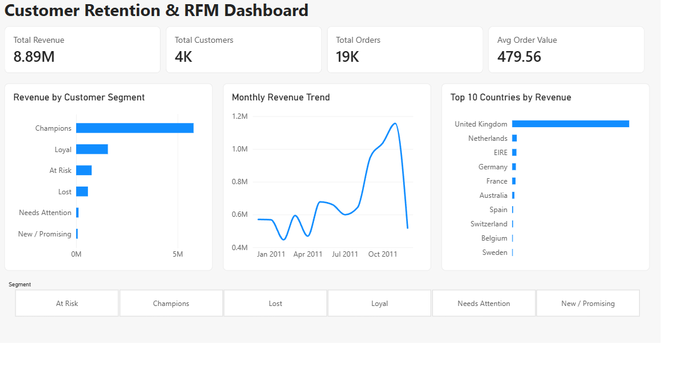
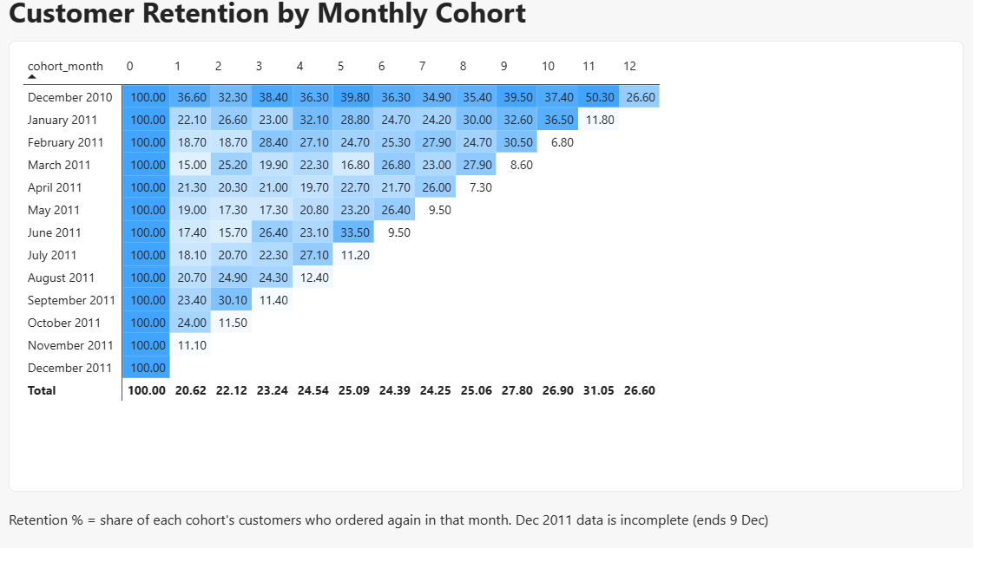

# Customer Retention & RFM Segmentation Analysis

**Tools:** MySQL, Power BI (DAX), Excel | **Dataset:** UCI Online Retail (UK-based online store)

## Business Problem
Acquiring a new customer costs far more than keeping an existing one. This project answers three questions for an online retailer:
1. Which customers generate most of the revenue?
2. Which valuable customers are drifting away and can still be won back?
3. How many customers come back after their first purchase?

## Dataset
- 541,909 transactions, 1 Dec 2010 to 9 Dec 2011, 38 countries
- Columns: InvoiceNo, StockCode, Description, Quantity, InvoiceDate, UnitPrice, CustomerID, Country

## Approach
| Step | What I did | File |
|---|---|---|
| 1. Import and profiling | Loaded the raw CSV into MySQL and checked data quality issues | `01_create_table.sql`, `02_data_checks.sql` |
| 2. Cleaning | Removed invalid rows and duplicates, converted dates, created `TotalPrice` | `03_cleaning.sql` |
| 3. RFM segmentation | Recency, Frequency, Monetary scores using `NTILE` and `CASE WHEN` | `04_rfm.sql` |
| 4. Cohort retention | Monthly cohorts using CTEs and window functions | `05_cohort.sql` |
| 5. Extra insights | Country revenue share used in the README | `06_insights.sql` |
| 6. Dashboard | 2-page Power BI report with DAX measures, slicer and retention heatmap | `Retail_RFM_Dashboard.pbix` |

### Data cleaning (541,909 rows to 392,688 rows)
| Issue found | Rows |
|---|---|
| Missing CustomerID (about 25% of data) | 135,080 |
| Cancelled invoices (InvoiceNo starts with C) | 9,288 |
| Negative quantity | 10,624 |
| Zero or negative unit price | 2,521 |
| Exact duplicate rows | 5,192 |

Some rows fall under more than one issue, so these counts overlap. Rows without a CustomerID were removed because RFM and cohort analysis need to identify the customer.

Final data: **392,688 rows, 4,338 customers, total revenue of about 8.89M (GBP)**.

## Key Insights
1. **Revenue is concentrated.** Champions are 22.6% of customers but bring 65.1% of revenue. The top 20% of customers generate 74.7% of revenue.
2. **A win-back opportunity exists.** The At Risk segment has 526 customers (12.1%) who used to buy often but have gone quiet. They hold about 764K in revenue (8.6%).
3. **Low repeat rate.** On average only 20.6% of a cohort buys again in the month after its first purchase. Roughly 4 in 5 new customers do not come back the next month.
4. **Retention stabilises, it does not collapse.** Retention settles at about 24% to 28% in later months, which points to a loyal core. The December 2010 cohort retains the best, at 30% to 50% in many months.
5. **Strong seasonal peak.** Monthly revenue rises sharply from September and peaks in November 2011 (about 1.15M).
6. **Heavy dependence on the UK.** The UK contributes 82.0% of revenue. Netherlands (3.2%), EIRE (3.0%), Germany (2.6%) and France (2.4%) follow far behind.

## Recommendations
- Protect Champions with early access, loyalty rewards and priority service, because losing them costs the most.
- Run a targeted win-back campaign (email or offer) for the 526 At Risk customers. It is cheaper than acquiring new customers.
- Do not spend heavily on the Lost segment (27.9% of customers but only 6.5% of revenue).
- Add a post-purchase journey in the first 30 days, such as a follow-up offer, to lift the 20.6% month-1 retention.
- Plan stock and marketing ahead of September to November, the peak season.
- Test growth in the Netherlands, EIRE, Germany and France to reduce dependence on the UK.

## Limitations
- Data ends on 9 Dec 2011, so the December 2011 cohort and month are incomplete.
- About 25% of rows had no CustomerID and are excluded. Results describe identified customers only.
- Customers 12346 and 16446 appear as top spenders because of one or two very large orders. They are not typical Champions.
- Retention for later months (10 to 12) is based on very few cohorts, so treat it with caution.
- RFM scores use `NTILE` quintiles. Customers with identical values (for example many with Frequency = 1) can land in different buckets, so segment boundaries are approximate.
- Retention here means "ordered in that month", not "ordered every month".
- Exact duplicate rows were removed as likely system errors. A customer could in rare cases buy the same item twice at the same minute.

## Dashboard



## Repository Structure
```
sql/            01 to 06 SQL scripts (run in order)
powerbi/        Retail_RFM_Dashboard.pbix
screenshots/    dashboard images
README.md
```

## How to Run
1. Download the Online Retail dataset from the UCI Machine Learning Repository and save it as CSV.
2. Run `01_create_table.sql` and import the CSV into `online_retail`.
3. Run `02_data_checks.sql` to see the data issues, then `03_cleaning.sql`, `04_rfm.sql`, `05_cohort.sql` and `06_insights.sql` in order.
4. Open the `.pbix` file in Power BI Desktop and connect it to your MySQL database (`retail_project`).

